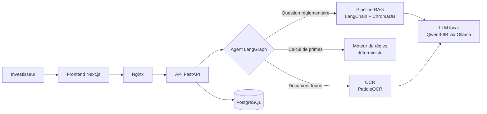

# CRI Assistant : agent IA open source pour l'accompagnement des investisseurs

> Assistant d'IA générative qui aide les investisseurs à comprendre la **Charte de l'investissement au Maroc (loi 03-22)**, à estimer leurs **primes d'investissement** et à vérifier leurs **documents**, avec un LLM hébergé **en local** pour garantir la confidentialité des données.

Projet conçu et développé en autonomie par **Mouloud Boutqlmount** pendant mon stage d'ingénieur IA & Data au **Centre Régional d'Investissement Guelmim-Oued Noun** (juillet à août 2026).


---

## Aperçu de l'interface

<!-- CAPTURES : glisser-déposer les images de l'interface ici -->

---

## Le problème

Les porteurs de projet qui s'adressent à un CRI posent souvent les mêmes questions : *quelles primes puis-je obtenir ? quelles conditions dois-je remplir ? mon dossier est-il complet ?* Les réponses se trouvent dans des textes juridiques longs (Charte de l'investissement, décrets d'application), difficiles à lire pour un non-juriste.

**CRI Assistant** répond à ces questions en langage naturel, cite les articles de loi utilisés, calcule les primes de façon fiable et vérifie les documents fournis.

## Fonctionnalités

- **Recherche réglementaire (RAG)** : réponses fondées sur la Charte de l'investissement (loi 03-22) et ses textes d'application, avec les sources citées.
- **Simulateur de primes** : calcul des primes d'investissement par un **moteur de règles déterministe**, pour éviter les erreurs de calcul du LLM.
- **Audit de documents par OCR** : extraction du texte des pièces fournies (PaddleOCR) et vérification de leur contenu.
- **Agent intelligent** : un agent **LangGraph** analyse chaque question et l'oriente vers le bon outil.
- **Confidentialité** : LLM open source **Qwen3-8B** exécuté en local via **Ollama**, sans envoi de données à une API externe. Des fournisseurs externes (Groq, DeepSeek) peuvent être activés en option.
- **Observabilité** : centralisation des logs avec Grafana, Loki et Alloy.

## Architecture



## Stack technique

| Couche | Technologies |
|---|---|
| IA générative | Qwen3-8B, Ollama, LangChain, LangGraph |
| Recherche documentaire | ChromaDB (base vectorielle), RAG |
| Vision | PaddleOCR |
| Backend | Python, FastAPI, PostgreSQL |
| Frontend | Next.js |
| Déploiement | Docker, Docker Compose, Nginx |
| Observabilité | Grafana, Loki, Alloy |
| Qualité | 272 tests automatisés |

## Structure du projet

```
cri-assistant/
├── backend/          # API FastAPI, agent LangGraph, RAG, moteur de règles, OCR
├── frontend/         # Interface Next.js
├── chroma/           # Base vectorielle ChromaDB
├── nginx/            # Configuration du reverse proxy
├── observability/    # Supervision et logs
├── compose.yaml      # Environnement de développement
├── compose.prod.yaml # Environnement de production
├── .env.example      # Variables d'environnement (développement)
└── .env.prod.example # Variables d'environnement (production)
```

## Installation

**Prérequis :** Docker et Docker Compose, et une carte graphique NVIDIA pour exécuter le modèle de 8 milliards de paramètres (Ollama tourne dans un conteneur).

```bash
# 1. Cloner le dépôt
git clone https://github.com/webDEV-project7/cri-assistant.git
cd cri-assistant

# 2. Configurer les variables d'environnement
cp .env.example .env
# puis définir vos propres identifiants dans le fichier .env

# 3. Lancer l'application
docker compose up -d --build

# 4. Télécharger le modèle dans le conteneur Ollama
docker compose exec ollama ollama pull qwen3:8b
```

L'application est ensuite accessible sur **http://localhost:8080**, et Grafana sur **http://localhost:3001**.

Pour la production : `docker compose -f compose.prod.yaml up -d --build`, avec un fichier `.env` basé sur `.env.prod.example`.

## Tests

Le projet est validé par **272 tests automatisés**.

```bash
docker compose exec backend pytest
```

## Choix techniques

- **Pourquoi un LLM local ?** Les dossiers des investisseurs contiennent des informations sensibles. Avec Ollama, aucune donnée ne quitte le serveur.
- **Pourquoi un moteur de règles pour les primes ?** Un LLM peut se tromper dans un calcul. Les montants sont donc calculés par du code déterministe et testé, et le LLM se charge uniquement de les expliquer.
- **Pourquoi un agent LangGraph ?** Chaque type de question demande un traitement différent. L'agent choisit le bon outil au lieu de tout confier au LLM.

## Auteur

**Mouloud Boutqlmount**, élève ingénieur en IA & Data à l'EMSI Rabat
- LinkedIn : [linkedin.com/in/mouloud-boutqlmount-691ba6403](https://linkedin.com/in/mouloud-boutqlmount-691ba6403)
- E-mail : boutqlmountm19@gmail.com
